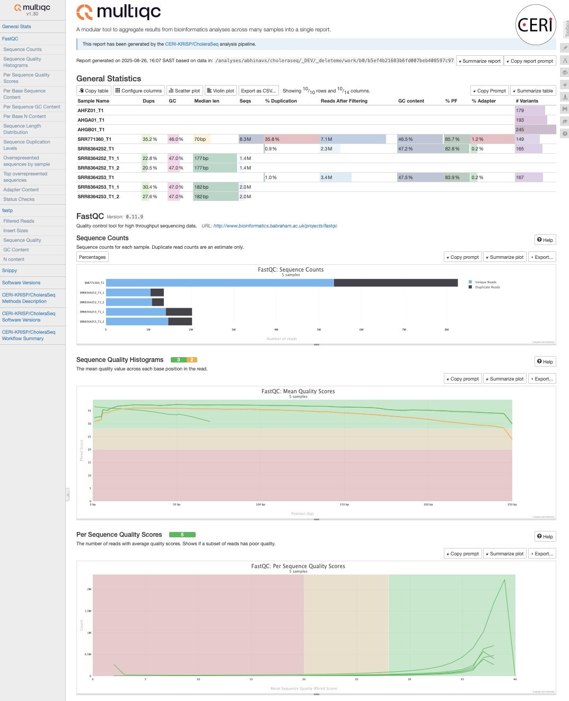

# Output

## Introduction

This document describes the output produced by the pipeline. Most of the plots are taken from the MultiQC report, which summarises results at the end of the pipeline.

The directories listed below will be created in the results directory after the pipeline has finished. All paths are relative to the top-level results directory.

<!-- TODO nf-core: Write this documentation describing your workflow's output -->

## Pipeline overview

The pipeline is built using [Nextflow](https://www.nextflow.io/) and processes data to produce the following results:

### Directory structure

As of `v1.1.0` the outputs of CholeraSeq pipeline are stored in the following directory structure. We intend to change this directory structure based on feedback from routine users.

```
├── abricate
├── cat
├── fastp
├── fastqc
├── filtlong
├── flye
├── gunzip
├── iqtree
├── mask
├── mlst
├── multiqc
│   ├── multiqc_data
│   └── multiqc_plots
├── nanoplot
├── pipeline_info
├── python
├── r
├── run
├── samtools
├── seqkit
├── snippy
├── spades
├── sra
└── utils

```

> 💡 **Hint**: `abricate`, `mlst`, and `spades` are only present if `--skip_amr`/`--skip_mlst`/`--skip_assembly` are `false` (the default). `sra` is only present when accessions are downloaded. `nanoplot`, `filtlong` and `flye` are only present when there are long-read samples; `gunzip` when there are long-read samples or gzipped assemblies.

### Assembly, typing & AMR

<details markdown="1">
<summary>Output files</summary>

- `spades/`
  - `<sample>.scaffolds.fa.gz`: SPAdes assembly (skipped for samples that were already contigs on input).
  - `<sample>.spades.log`: SPAdes run log.
- `mlst/`
  - `<sample>.tsv`: MLST sequence type call.
- `abricate/`
  - `<sample>.txt`: AMR/virulence/plasmid gene hits.

</details>

[SPAdes](https://github.com/ablab/spades) performs de novo genome assembly for samples supplied as reads (samples already supplied as contigs skip this step). [MLST](https://github.com/tseemann/mlst) and [ABRicate](https://github.com/tseemann/abricate) then run on the resulting assembly (or the original contigs).

### Long-read QC and assembly

<details markdown="1">
<summary>Output files</summary>

- `nanoplot/`
  - `<sample>_NanoPlot-report.html`, `<sample>_NanoStats.txt` and plots: read-length and quality QC for each Nanopore/PacBio sample (on the unfiltered reads).
- `filtlong/`
  - `<sample>.fastq.gz`: the filtered reads used for assembly. These can be large.
  - `<sample>.log`: Filtlong log.
- `flye/`
  - `<sample>.assembly.fasta.gz`: the Flye assembly.
  - `<sample>.assembly_info.txt`: contig lengths, coverage and circularity.
- `gunzip/`
  - Uncompressed copies of the long-read assemblies and of any gzipped input assemblies, as passed to variant calling.

</details>

[NanoPlot](https://github.com/wdecoster/NanoPlot), [Filtlong](https://github.com/rrwick/Filtlong) and [Flye](https://github.com/mikolmogorov/Flye) handle Nanopore and PacBio samples. Each assembly then follows the same path as any other assembly. A sample whose assembly fails has no files here; see `pipeline_info/execution_trace_*.txt`, where it is listed as `FAILED`.

### SRA download

<details markdown="1">
<summary>Output files</summary>

- `sra/`
  - `<sample>*.fastq.gz`: reads downloaded for samplesheet rows using the `sra_id` column, or accessions supplied via `--sra_list`.

</details>

### MultiQC

<details markdown="1">
<summary>Output files</summary>

- `multiqc/`
  - `multiqc_report.html`: a standalone HTML file that can be viewed in your web browser.
  - `multiqc_data/`: directory containing parsed statistics from the different tools used in the pipeline.
  - `multiqc_plots/`: directory containing static images from the report in various formats.

</details>

[MultiQC](http://multiqc.info) is a visualization tool that generates a single HTML report summarising all samples in your project. Most of the pipeline QC results are visualised in the report and further statistics are available in the report data directory.



Results generated by MultiQC collate pipeline QC from supported tools e.g. FastQC. The pipeline has special steps which also allow the software versions to be reported in the MultiQC output for future traceability. For more information about how to use MultiQC reports, see <http://multiqc.info>.

### Pipeline information

<details markdown="1">
<summary>Output files</summary>

- `pipeline_info/`
  - Reports generated by Nextflow: `execution_report.html`, `execution_timeline.html`, `execution_trace.txt` and `pipeline_dag.dot`/`pipeline_dag.svg`.
  - Reports generated by the pipeline: `pipeline_report.html`, `pipeline_report.txt` and `software_versions.yml`. The `pipeline_report*` files will only be present if the `--email` / `--email_on_fail` parameter's are used when running the pipeline.
  - Reformatted samplesheet files used as input to the pipeline: `samplesheet.valid.csv`.

</details>

[Nextflow](https://www.nextflow.io/docs/latest/tracing.html) provides excellent functionality for generating various reports relevant to the running and execution of the pipeline. This will allow you to troubleshoot errors with the running of the pipeline, and also provide you with other information such as launch commands, run times and resource usage.